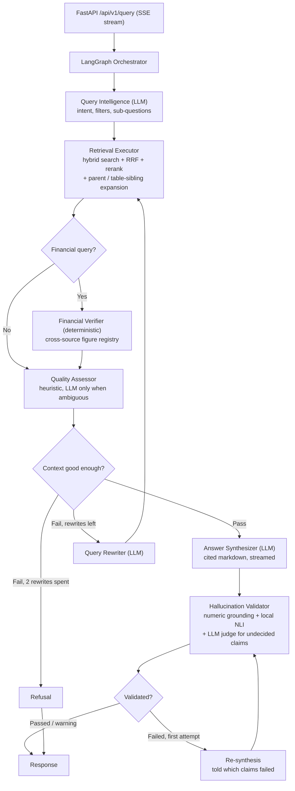

# Redline

**Evidence-grounded M&A due diligence.** Ask a question of a deal's data room; get an answer where every claim is traced to its source and every figure is checked against it — or a clear statement of what the documents don't say.

[](https://github.com/Makilesh/redline-diligence/actions/workflows/ci.yml)
[](https://www.python.org/)
[](https://qdrant.tech/)
[](https://github.com/langchain-ai/langgraph)
[](LICENSE)

Redline is a **hybrid agentic RAG engine for M&A (mergers & acquisitions) due diligence**. It ingests a multi-format data room — financial statements, merger agreements, board decks, credit agreements — and answers questions that require combining facts across several documents. The name is the term of art for a marked-up contract draft; the engine tracks redlines as first-class metadata.

The design constraint that shapes everything: **in due diligence a wrong number is a hard failure, not graceful degradation.** A reviewer told "I can't find this" loses a minute. A reviewer given a confident, wrong EBITDA figure can misprice a deal. So the engine is built to refuse, every figure in an answer is checked against the source text, and refusal is measured as carefully as accuracy.

---

## What it looks like

> **Q: What is the Section 280G excise tax exposure and which executives trigger it?**
>
> **Total potential Section 280G excise tax exposure: $2.4 million**
> **Executives triggering excess parachute payments:** Marsh (CEO), Wu, and Chen.
>
> Marsh, Wu and Chen are expected to exceed the Section 280G safe harbour threshold, exposing the Company to a 20% excise tax and the loss of the corresponding corporate tax deduction `[employment_and_retention_agreements.txt | Section 280G]`. The Company has **not** obtained a shareholder cleansing vote…

No single passage states all of this. The exposure figure, the affected executives and the cleansing-vote status sit in different sections, and the question has to be decomposed before any of them can be retrieved. Each figure in the answer ($2.4 million, 20%) is then located in the retrieved text before the answer is shown.

---

## Table of Contents
- [Architecture](#architecture)
- [Ingestion](#ingestion)
- [Retrieval](#retrieval)
- [Answer verification](#answer-verification)
- [Decision layer (Laya)](#decision-layer-laya)
- [Model routing & quota engineering](#model-routing--quota-engineering)
- [Evaluation](#evaluation)
- [Public demo guardrails](#public-demo-guardrails)
- [Technology Stack](#technology-stack)
- [Quick Start](#quick-start)
- [Engineering notes](#engineering-notes)
- [Limitations](#limitations)
- [Roadmap](#roadmap)
- [Project Structure](#project-structure)

---

## Architecture

A **LangGraph StateGraph** sharing typed state across nine nodes, checkpointed to Postgres by `(deal_id, session_id)`. Only the nodes that genuinely need language understanding call an LLM; retrieval strategy, financial verification and most of answer verification are deterministic or run on small local models, because on a free API tier every avoided call is capacity for the one that matters — synthesis.



| # | Node | Role | LLM? |
|---|---|---|---|
| 1 | **Query Intelligence** | Classifies intent, extracts metadata filters, decomposes multi-fact questions into sub-questions | Lite model |
| 2 | **Retrieval Strategy** | Picks dense/sparse weights and top-k by query type | No — a lookup |
| 3 | **Retrieval Executor** | Hybrid search over Qdrant, Reciprocal Rank Fusion, cross-encoder rerank, parent-section and table-sibling expansion | No |
| 4 | **Financial Verifier** | Builds a registry of every figure in the financial context and flags the same metric reported differently across sources | No |
| 5 | **Quality Assessor** | Scores whether the retrieved context can support an answer at all | Only in the ambiguous band |
| 6 | **Query Rewriter** | Reformulates and relaxes filters when retrieval comes back thin (max 2 loops; its config changes are whitelisted and clamped) | Lite model |
| 7 | **Answer Synthesizer** | Writes the cited answer to the user's original question, or declines; streams tokens | Reasoning model |
| 8 | **Hallucination Validator** | Grounds every figure deterministically, checks every claim with a local NLI model, and asks an LLM judge only about claims neither could decide | Only for undecided claims |

A typical query makes **2–3 LLM calls** (previously 3–4, one of which re-derived arithmetic the code can do exactly).

---

## Ingestion

Every advertised format has a fixture test that builds a real file and runs it through the production path (`tests/test_ingestion_formats.py`).

- **PDF** — PyMuPDF text rebuilt as visual rows, so a financial statement's label and its figures stay on one line under the right year; a run of label + amount rows under a period header is recognised as a table even without ruling lines (the usual 10-K layout). Headings come from per-page font statistics, running headers and footers are dropped, and passages carry their real page.
- **Multi-page table stitching** — `pdfplumber` tables are fingerprinted by column structure and header similarity; a headerless table on the *next* page is stitched onto its predecessor into one table with a page range.
- **DOCX** — clean text is the document with tracked insertions accepted and deletions dropped; content controls, nested tables and bold article lines are read; genuinely changed paragraphs are indexed separately as redlines.
- **XLSX / PPTX** — workbooks are read cell by cell (merged and two-row headers, percentage formats, captions, stacked tables, hidden sheets flagged, formulas without a cached value flagged rather than read as empty); PPTX keeps slide numbers, speaker notes and text inside group shapes.
- **Plain text** — a heading-aware parser (ALL-CAPS lines, `Section 1.2 —`, `#`) so citations name a real section; aligned tables keep their column header; Windows-1252 and UTF-16 files are decoded correctly. No page number is invented for formats that don't have pages.
- **Unreadable files fail loudly** — an encrypted, corrupt or scanned (no text layer) PDF, an encrypted or legacy Office file, or a binary file named `.txt` is rejected with that reason, never indexed as empty text.

**Tables are stored four ways under one `table_id`**: a narrative for dense matching, row-by-row key–value pairs for exact lookup, a deterministically computed metrics summary (YoY growth, CAGR, margins — pandas, not the LLM), and a markdown grid. **Every representation prints each cell exactly as the document states it** — under "($ in millions, except per share)" EPS stays 2.74 — and states the unit once; normalised values live only in typed `structured_rows`, which the cross-document figure registry reads. Growth is computed only between fiscal years that are actually consecutive, CAGR over the real span, and nothing is emitted when the arithmetic is undefined. Retrieving any one representation pulls the whole grid, in order.

**Parent–child chunks**: ~512-token child chunks are what gets searched (hard cap 800); ~2048-token parent sections are what the synthesizer and validator read.

**Ingest is idempotent.** `doc_id` is derived from the deal and the file's SHA-256, point IDs from the chunk ID, so re-uploading identical bytes replaces rather than duplicates. A failed upsert rolls back every point already written for that document, and a failed re-index keeps the copy that was serving. A document a newer version retired stays retired when re-indexed, and an upload that looks like a new version of an existing file comes back with a `version_candidates` proposal — superseding stays an explicit choice. Uploads are size-capped before buffering, filenames sanitised, Office archives checked for zip bombs, and parsing runs off the event loop.

Personal identifiers (SSNs in any separator style, account numbers, IBANs with a mod-97 check, payment cards with a Luhn check, individual pay stated in prose) and risk signals (change of control, MAC clauses, litigation…) are detected at ingestion, and each document is categorised. Risk signals and categories are decided with a local decision model on top of the rules — see [Decision layer](#decision-layer-laya); PII stays rule-based. PII-flagged chunks are excluded from retrieval by default. Named-executive compensation is deliberately **not** treated as PII: in a data room it is diligence content (280G exposure, change-of-control cost), and hiding it would refuse questions a reviewer is there to ask ([Decision 59](DECISIONS_LOG.md)).

---

## Retrieval

- **Hybrid dense + sparse** — `BAAI/bge-m3` (1024-dim) and BM25 in one Qdrant deployment, fused with a rank-based **Reciprocal Rank Fusion** that ignores raw scores to avoid scale mismatch. Text is normalised before BM25 on both the document and the query side (case, punctuation, figures such as `$452.8M`) and Qdrant applies IDF; each chunk records which encoding wrote its sparse vector, so an index that predates a change is reported at startup instead of silently missed. (The keyword channel was case-sensitive until November 2026 — [Decision 52](DECISIONS_LOG.md).)
- **Cross-encoder rerank** — `BAAI/bge-reranker-v2-m3` locally (`ms-marco-MiniLM-L-6-v2` on the CPU-only host), sigmoid-normalised to [0, 1], half precision on a GPU. Every pass of a decomposed question is scored in **one** call, longest pairs first: p50 latency 943 → 144 ms per question.
- **Section and table completion** — a retrieved paragraph brings the table printed in its own section, and a retrieved table brings its exact grid, whole and in order, directly after the chunk that hit.
- **Sub-question decomposition** — query expansion rephrases the same question and cannot retrieve a fact the question never asks for. A multi-fact question is split into atomic sub-questions, each retrieved in **its own pass and reranked against itself**, then merged so every facet keeps a share of the context. A passage containing only a share price scores near zero against "what is the implied EV/EBITDA multiple?" and high against "what is the per-share merger consideration?".
- **Server-enforced filters** — deal isolation, the current-version filter and PII exclusion are applied by the server on every query, on both search channels (pinned by a test). The only filter a model may propose is a known document category; it cannot see superseded versions or PII, because those conditions are never read from model output.
- **No silent fallback** — the Qdrant backend is set by `QDRANT_MODE` (`server`, the default, or `local` for development). An unreachable server fails startup; it used to fall back to an empty local index that answered nothing while the health check stayed green ([Decision 54](DECISIONS_LOG.md)).

---

## Answer verification

A validator that is itself an LLM grading another LLM tells you what one model thinks of another. This one checks, cheapest first:

1. **Numeric grounding (deterministic).** Every figure in the answer — `$452.8M`, `USD 1.2bn`, `17.0%`, `8.5x`, `24 months` — is extracted, unit-normalised, and located in the retrieved text within rounding tolerance, **at the unit its document declares and in the row or sentence the claim names, for the period it names**. A real figure attached to the wrong metric or year is not grounded: "net income was $452.8M", where $452.8M is revenue, goes to the judge instead of passing. Ratios are never rescaled, and a bare number in prose grounds nothing — before this, 33.5% of *random* "$X.Y billion" figures and 48.5% of random whole percentages were accepted. Years, dates, section numbers (`280G`, `4.3(a)`) and page references are skipped. A figure computed from grounded inputs counts as *derived* only when those inputs are found; anything else is *unsupported*.
2. **Claim-level support (local model).** Each claim is scored against sentence-sized windows of the chunks it cites, plus the best lexical matches elsewhere — a correct claim with a sloppy citation isn't failed for the citation alone. On GPU by `FactCG-DeBERTa-v3-Large`, a grounding checker trained for exactly this, which catches flipped negations and swapped parties a general NLI model entails; on CPU by `cross-encoder/nli-deberta-v3-xsmall`. Each model has its own thresholds, calibrated on the benchmark below, and a checker that fails to load falls back to `nli-deberta-v3-small` and says so in `/health`.
3. **LLM judge, only when needed.** Claims neither step could decide go to a lite model in **one batched call**; the common case makes none. An NLI contradiction alone never fails an answer: in calibration, all five of the small model's ≥0.9-confidence contradictions were wrong, so a contradiction must be confirmed by the judge.

An answer **fails** on any confirmed contradiction or any figure not found in the context, and gets **one** re-synthesis that is told exactly which claims failed. It is a **warning** when non-numeric claims can't be confirmed. **Confidence is computed, not self-reported**: the share of supported claims, averaged with the share of grounded figures when there are any. Every claim's figures are checked; statements of absence ("no litigation is disclosed") are verified rather than skipped, because a false absence tells a reviewer a risk does not exist; a claim beyond the checking budget is reported *not checked*, never supported; and a failed synthesis is never verified as if it were an answer. Per-claim results — verdict, method, figures, evidence passage — are returned as `claim_checks` and shown in both UIs.

**Measured on a labelled benchmark** ([`eval/verification_set.json`](eval/verification_set.json): 542 claims written against the sample data room — verbatim, paraphrased and computed support; facts the room never states; changed figures, real figures on the wrong metric or period, swapped parties, flipped negations, wrong units, false "not disclosed" — split dev/test by fact family). On the held-out half, the deterministic stages pass **6.7%** of wrong claims (from 40.9%) and flag **0%** of correct ones (from 2.1%). With the local model in the loop: on GPU (FactCG) still **6.7%** of wrong claims pass — the same claims the figure checks already settle, none added by the model — and **3.0%** of correct ones are flagged, with 35% of claims left to the LLM judge; `nli-deberta-v3-small`, the previous GPU model, passed 9.7% and flagged 5.0%. On CPU, `-xsmall` passes 10.9% and flags 1.0%. Five checkers were compared (MiniCheck ×3, FactCG, HHEM) with thresholds chosen on the dev half only ([Decision 63](DECISIONS_LOG.md)). CI fails on a regression ([`eval/verification_baseline.json`](eval/verification_baseline.json)).

Document text is wrapped in escaped `<document>` tags and every prompt that reads it — synthesis, validation, the quality gate — treats it as untrusted data; figures and labels the code extracts from documents go in as escaped `<finding>` elements, never as trusted prompt text. In M&A the data room comes from the counterparty, so prompt injection is adversarial input by design, not a hypothetical.

---

## Decision layer (Laya)

**LLMs generate, code computes, a decision model judges.** Many of the pipeline's steps are not generation at all but typed judgments — *does this passage disclose litigation?*, *what kind of document is this?*, *is this question about the deal?* — and they were being made by regexes or by spending an LLM call. [Laya](https://huggingface.co/convaiinnovations/laya) (Apache-2.0, 421M parameters) answers typed questions in one encoder forward pass with a probability instead of prose: ~30 ms per question on a GPU, runs locally, costs nothing, and cannot hallucinate text. The authors' fine-tuned `typed-decisions` checkpoint is used as-is; nothing here is fine-tuned yet.

Every use was measured against the method it would replace on a labelled set built for it — thresholds chosen on a dev split, results reported on a held-out split — and adopted **only where it won**. Every use falls back to the previous rule-based path when Laya is unavailable ([`src/decisions/`](src/decisions)).

| Decision | Before | With Laya | Status |
|---|---|---|---|
| **Risk signals** at ingest (10 categories) | regex, F1 0.583 (P 0.81 / R 0.46) — negations such as "no pending litigation" flagged as risks | regex + Laya hybrid, **F1 0.658 (P 0.89 / R 0.52)** on GPU; on CPU a confirm-only mode, P 1.00 / R 0.46, to keep ingest fast | **On** |
| **Document category** at ingest | filename/keyword rules, accuracy 0.77 | **0.95** | **On** |
| **Public query guard** before any LLM call | none — off-topic and jailbreak prompts spent 2–3 Gemini calls each | blocked **23/27** junk prompts with **0/124** false blocks on genuine questions | **On** (public callers only) |
| **Answerability gate** (does any retrieved passage *state* the answer?) | reranker-score heuristic: measures relevance, so on-topic questions whose figure is absent get through | golden test set: unanswerable controls refused **2 → 4 of 6** (none left to the LLM), answerables admitted unchanged (33/35); dev set 1/28 → 10/28 refused with 0/26 wrongly vetoed; 0 LLM calls, ~60 ms on GPU, ~0.9 s at 2 CPU threads (pairs scored best-first, stopping at the first that clears the veto) | **On** (GPU); off on the CPU server, where it would wrongly veto one golden question with the MiniLM reranker |
| **PII** at ingest | regex (fixed: bare 9-digit numbers and pay pools no longer count) | lower precision, and hid a chunk the golden set needs | **Not adopted** — the regex was extended instead (dotted SSNs, IBAN, Luhn-checked cards, prose salaries): audit probes found 5/12 → 11/12, 0/18 hard negatives flagged |

The checkpoint is loaded at a pinned Hub commit (`LAYA_REVISION`), so an upstream weight change cannot move these thresholds without a line of this repository changing. The labelled sets are small and single-annotator, so a chunk or two moves F1 by a few points — every number here now carries a Wilson or bootstrap interval ([`eval/decisions/stats.py`](eval/decisions/stats.py)). Details, confusions and sweeps are in [`eval/decisions/results.md`](eval/decisions/results.md), [`eval/results/query_guard.md`](eval/results/query_guard.md) and [`eval/results/answerability_dev.md`](eval/results/answerability_dev.md). Fine-tuning Laya on domain labels is the next step for risk recall.

---

## Model routing & quota engineering

The Gemini free tier is lopsided in a way that dictates the whole design: every reasoning-grade model is capped at **20 requests/day**, while the Lite tier allows **500**.

| Model | RPM | RPD | Role |
|---|---|---|---|
| `gemini-3.7-flash` | 5 | 20 | Synthesis (newest reasoning) |
| `gemini-3.6-flash` | 5 | 20 | Synthesis |
| `gemini-3.5-flash` | 5 | 20 | Synthesis |
| `gemini-3-flash-preview` | 5 | 20 | Synthesis |
| `gemini-2.5-flash` | 5 | 20 | Synthesis — grandfathered keys only |
| `gemini-3.5-flash-lite` | 15 | **500** | Agents — volume tier |
| `gemini-3.1-flash-lite` | 15 | **500** | Agents — volume tier |
| `gemini-2.5-flash-lite` | 10 | 20 | Agents — grandfathered keys only |

Putting agent traffic on a reasoning model would drain it in five queries and leave nothing for synthesis — the one call whose quality reaches the user. Hence **two ladders**: the agent ladder ordered by *daily capacity* with reasoning models excluded (enforced by a test), and the synthesis ladder ordered by *capability*, spilling to Lite only once the good models are spent, and finally to local Ollama.

**Keys multiply capacity, so rotation drains one key on a model before stepping down a rung** — answer quality degrades last, not first. That required a non-blocking `try_acquire()`: the natural `acquire()` sleeps until the rate window opens, which would block on a saturated key while another sat idle. Google meters per *project*, not per key, so this holds only when each key comes from a different Google Cloud project; the tracker warns when two keys behave like one.

**Failures are classified by what they actually mean**, because each implies a different repair:

| Signal | Meaning | Response | Daily unit |
|---|---|---|---|
| 429, per-day quota | this key is spent on this model today | mark the slot spent, rotate to another key | slot set to its limit |
| 429, per-minute quota — or a request that would overrun TPM | the slot is busy this minute | rest the slot for the provider's retry delay, rotate | refunded |
| 503 | the model is unresponsive for everyone | skip the model, escalating per-model backoff | refunded |
| timeout / 5xx | same — but the request was admitted | skip the model, escalating per-model backoff | kept |
| 404 "no longer available" | this key may never use this model | retire that one slot, permanently | refunded |
| auth error | the credential is bad | retire the key across all models | refunded |
| 200, unusable JSON | the model ignored the output contract | one paid repair request, then another model for this request only | each request counted |

That taxonomy is not academic. `gemini-2.5-flash` answers on two of five configured keys and 404s on the rest — Google grandfathers older keys when a model closes to new sign-ups, so **availability is a property of the (key, model) pair, not of the model.** Retiring the model would have discarded real capacity; retiring the key would have discarded more.

Quotas live in one table — [`src/llm/model_registry.py`](src/llm/model_registry.py) — with invariant tests, because two earlier quota bugs were arithmetic errors over constants duplicated across three files.

The taxonomy is applied in one place, the call wrapper, so every agent gets it: a structured call that fails on its selected slot descends the ladder itself, and ends on local Ollama. The same wrapper keeps the count honest — selection pays for one request, every retry pays for itself, and a request the provider refused gives its unit back — and the daily counters turn over when Google's do, at midnight Pacific. LiteLLM's own `Router` was evaluated for this job and not adopted: it has no per-day limit, and on a 503 it retries the same deployment and then tries the *next key on the same model*, which is the opposite of what a model-wide outage calls for ([Decision 51](DECISIONS_LOG.md)).

---

## Evaluation

Validated against a synthetic data room of **9 documents (~13K tokens, 58K characters)** — committed in [`data/sample_deal/`](data/sample_deal) — with a hand-built golden set of **41 questions: 35 answerable** (10 of them multi-hop) plus **6 unanswerable controls** whose answers are absent by construction. The controls are what make the answer rate falsifiable — without them, "always finds the answer" and "never refuses" produce identical numbers.

### Retrieval (committed harness, deterministic, zero LLM calls)

[`eval/`](eval) indexes the corpus into an in-memory Qdrant with the real models and runs the production retrieval node. Relevance is derived from the golden facts, so no chunk IDs need hand-labelling; sub-questions were generated once by the real Query Intelligence node and cached, so reruns make no API calls and two runs produce identical numbers. CPU and GPU runs match to 1e-4 on reranker scores.

| ablation | fact coverage@10 | fact coverage (final context) | recall@10 | MRR@10 | nDCG@10 | p50 / p95 ms |
|---|---|---|---|---|---|---|
| dense only | 88.8 | — | 69.8 | 60.1 | 59.8 | 20 / 25 |
| sparse only (BM25) | 95.2 | — | 78.0 | 68.7 | 68.9 | 20 / 25 |
| hybrid RRF, no rerank | 97.1 | — | 80.1 | 69.0 | 69.6 | 21 / 26 |
| **production** (hybrid + rerank + expansion) | 94.3 | **97.1** | 78.7 | 77.2 | 73.8 | **144 / 182** |
| **production + decomposition** | 95.2 | **98.1** | **81.2** | **77.7** | **75.7** | 153 / 512 |

*Fact coverage* is the share of a question's expected facts present in the retrieved text; the ceiling on this corpus is 99.0% (one expected figure is a computed multiple that appears in no document). Every mean in the harness output carries a 95% bootstrap interval and every difference a paired one — on 35 questions one question is worth up to 2.9 points, so most single-row differences are within noise and are reported as such.

**Before → after the November 2026 rework**, paired on the same questions: final-context fact coverage 91.6 → 97.1 (+5.5 [0.0, +12.4]), latency p50 943 → 144 ms and p95 1249 → 182 ms (with decomposition, p95 4572 → 512 ms); ranking metrics within noise. The keyword channel was the big fix — BM25-only fact coverage@10 73.1 → 95.2 — but on a corpus this small the reranker had been hiding it.

**With realistic noise.** `--distractors 60` adds 60 real commercial contracts (CUAD, CC BY 4.0; ~3,300 chunks, ~1.06M tokens) to the same deal, which is where retrieval quality actually separates. There, the keyword fix alone moves production fact coverage@10 78.9 → 91.6 (+12.7 [+3.4, +23.6]) and MRR@10 67.5 → 77.6 (+10.1 [+1.5, +20.6]); the refusal gate still admits every answerable question it admitted without the noise.

A reference row in the harness output shows that handing the whole ~13K-token corpus to the model reaches the fact-coverage ceiling: on this corpus fact coverage cannot separate a retrieval design from context stuffing — ranking quality, the distractor run and the refusal gate can.

Run it: `python -m eval.run_retrieval_eval --baseline eval/baseline.json` — exits non-zero on a regression beyond tolerance; `--compare <previous.json>` gives paired deltas, `--distractors N` the noise run. It runs in CI on demand and weekly. Details and caveats in [`eval/README.md`](eval/README.md).

### End-to-end (live, quota-dependent)

`tests/run_end_to_end_validation.py` drives the whole pipeline through the API against a freshly re-indexed data room. The latest run (2026-11-15, after the November rework) next to the run previously committed in [`RESULTS.md`](RESULTS.md) (2026-08-25):

| Metric | 2026-08-25 | **2026-11-15** |
|---|---|---|
| Completed without an unhandled exception | 41/41 | 41/41 |
| Answerable questions answered | 35/35 | 35/35 |
| Mean fact recall | 80.1% | **90.5%** |
| Answers containing every expected fact | 20/35 | **27/35** |
| Citation-source match | 31/35 | **33/35** |
| Controls where the engine did **not** fabricate | 6/6 | 6/6 |
| Latency p50 / p90 | 27.0 s / 63.6 s | **14.6 s / 33.5 s** |
| Verification: passed / warning / failed | 36 / 5 / 0 | 8 / 26 / 7 |
| Synthesis model mix | `3.6-flash` ×33, `3.5-flash` ×4, `3-flash-preview` ×1 | `3-flash-preview` ×46, `2.5-flash` ×5 |

Two things to read before comparing. **The November run was served by a lower rung**: during it, `gemini-3.7-flash` timed out and `3.6`/`3.5-flash` returned 503 "high demand"; each was cooled model-wide and synthesis moved down the ladder with no answer lost (the slowest query is one 120 s timeout before that happened). The gains above came despite that, but the runs are not controlled for model. **The verification mix moved because the checker got stricter, not because answers got worse**: the August validator passed 36 of 41 answers while the benchmark later showed it let 41% of wrong claims through. Of the seven November failures, one is a clear catch (mh_06: a computed closing-cash total that appears in no document, 0% recall), one flags a percentage column the model invented, and five are judge-confirmed contradictions where an answer mis-stated or embellished a detail.

Runs before Decision 66 gave synthesis 3,000 tokens, shared with thinking. In the 2026-11-15 evening run, 29 of 54 synthesis calls ran out. mh_05 and mh_04 shipped as ~500-character fragments, and mh_06 was lost when three rungs were cut off before their first citation. Those runs understate multi-hop recall.

**One caveat matters enough to state up front.** End-to-end recall on this set moves with *which synthesis model served the run*, and that depends on daily quota and provider health rather than on anything in this repository. Runs of identical questions against an identical index have scored 86.6%, 73.9%, 71.0%, 85.9%, 62.1%, 86.3% and 80.1% on the earlier pipelines — the 62.1% run coincided with a Gemini incident that truncated a third of its answers, and 86.3% and 80.1% are both clean runs with zero answers lost upstream ([Decision 48](DECISIONS_LOG.md)) — and 90.5% on the November pipeline, with zero answers lost despite three reasoning models being down during the run. [`RESULTS.md`](RESULTS.md) therefore records the synthesis model mix and upstream-failure count with every report, and retrieval changes are measured with the deterministic harness above instead.

The refusal path is a feature, not a fallback: on all 6 controls the engine declined to invent the missing figure — usually by answering the part it *could* support and naming the gap explicitly. The retrieval harness shows where that behaviour comes from: the context-quality gate refuses 2 of the 6 controls outright, sends 1 to the LLM, and admits 3 whose documents are on-topic but lack the asked-for figure — for those, it is synthesis and verification that decline.

---

## Public demo guardrails

The hosted demo runs on free tiers and is open to anyone, so the API assumes it will be scripted against ([`api/security.py`](api/security.py)):

- **Per-IP rate limits** on queries (5/min, 50/day) and uploads, a **concurrency cap** that answers 503 immediately instead of queueing, and a **global daily query cap** as the last guard on the shared Gemini quota.
- **Visitor sandboxes.** Uploads go to a per-visitor sandbox deal with a TTL; sandboxes are hidden from other visitors, and their creation time is encoded in the ID so the sweeper reclaims orphans even after a restart. The demo deal cannot be written to or deleted without the admin key.
- **Query guard.** A local decision model screens public questions for off-topic, jailbreak and prompt-injection content before any LLM call is made — measured at 0 false blocks on 124 genuine questions.
- **Read access is explicit.** Public callers can read only the deals in `PUBLIC_DEAL_IDS` and their own sandbox; any other deal answers 404 without the admin key.
- **Compliance override is server-side.** `include_pii` is forced off for public callers.
- **No internal errors leak.** Clients get a generic message and a request ID — on the streaming route too, and in the agent trace, which carries only a failure class; the detail goes to the log. Request bodies are size-capped before they are buffered.
- **Abandoned work stops.** A client that disconnects cancels its run on both query routes, so a closed tab does not keep spending model quota; runs and nodes have deadlines, and shutdown drains in-flight queries.
- **The service reports its own state.** `/ready` reflects whether the checkpointer is durable, which Qdrant backend is live and whether any chunk was indexed under an old encoding; `/metrics` (admin) gives per-node p50/p95, LLM calls and tokens. More than one API worker is refused at startup, because rate limits and quota windows are per process.

---

## Technology Stack

| Component | Technology | Detail |
|---|---|---|
| **Orchestration** | LangGraph 1.x | StateGraph + Postgres checkpointer (in-memory fallback is reported by `/ready`; `REQUIRE_DURABLE_CHECKPOINTS` refuses it in production) |
| **Vector Database** | Qdrant | Hybrid (dense + sparse) search; self-hosted, Qdrant Cloud, or in-memory for eval |
| **LLMs (Cloud)** | Gemini via LiteLLM | Capability-tiered ladders + multi-key rotation |
| **LLM (Local)** | Ollama / Qwen2.5-14B | Final fallback when all cloud quota is spent (local runs only) |
| **Embeddings** | BAAI/bge-m3 | 1024-dim dense + FastEmbed BM25 sparse (normalised text, IDF) |
| **Reranker** | BAAI/bge-reranker-v2-m3 | Cross-encoder, sigmoid-normalised, fp16 on GPU |
| **Verification** | FactCG-DeBERTa-v3-Large (GPU) · nli-deberta-v3-xsmall (CPU) | Local claim-level grounding check, per-model calibrated thresholds |
| **Decisions** | Laya `typed-decisions` | Local typed yes/no and choice judgments with probabilities |
| **API** | FastAPI | SSE streaming, structured JSON logging, rate limiting |
| **Frontend** | Next.js (hosted) · Streamlit (local console) | Streamed pipeline timeline, citations, sandbox uploads |
| **Database** | PostgreSQL | Quota tracking, LangGraph checkpoints |
| **Observability** | Langfuse (optional) | LLM call tracing via LiteLLM callbacks when keys are set |

Deployed as a Next.js frontend on Vercel and a single Linux VM running the API, Qdrant and Postgres behind Caddy (automatic HTTPS) via `docker-compose.prod.yml`. See [`DEPLOYMENT.md`](DEPLOYMENT.md).

---

## Quick Start

### 1. Prerequisites
Docker and Python 3.11+.

### 2. Setup

```bash
git clone https://github.com/Makilesh/redline-diligence.git && cd redline-diligence
cp .env.example .env
# Edit .env — add GEMINI_API_KEYS (one or more, comma-separated) and the DB password

pip install -r requirements-dev.txt   # runtime + test tooling

# PyTorch for your GPU. --force-reinstall --no-deps is required: a plain
# `pip install torch --index-url ...` reports "Requirement already satisfied"
# against an existing CPU build and silently leaves it in place.
pip install --force-reinstall --no-deps torch --index-url https://download.pytorch.org/whl/cu128
```

Verify the GPU is actually in use — this failure is silent and costs about 5x on every query:

```bash
python -c "import torch; print(torch.__version__, torch.cuda.is_available())"
```

Anything ending `+cpu`, or `False`, means the embedding, reranker and NLI models run on CPU: answers are identical, but retrieval goes from under a second to 6–18s per pass. Use `cu128`+ for RTX 50-series (Blackwell), `cu118`/`cu124` for older cards.

### 3. Run it

```bash
python run_demo.py            # --reindex to rebuild the index from scratch
```

Starts Docker Desktop if needed, brings up Postgres and Qdrant, waits for each to be genuinely healthy, starts the API, ingests the sample data room if the index is empty, warms the local models, and opens the UI at `http://localhost:8501`. `--stop` shuts the containers down. **After upgrading from an index built before November 2026, run once with `--reindex`**: the keyword channel's text encoding and the table text both changed, and startup logs how many chunks still carry the old encoding.

Without a Qdrant server (development only), set `QDRANT_MODE=local` to use an embedded on-disk index; the API no longer falls back to one on its own.

<details>
<summary>Other ways to run</summary>

**Fully containerized:** `docker compose up -d` — API on `:8000`, UI on `:8501`.

**Development:** `docker compose up postgres qdrant -d`, then `python run_api.py` and `streamlit run app/streamlit_app.py`. The Next.js frontend: `cd web && npm ci && npm run dev`.

`run_api.py` rather than `uvicorn api.main:app`, because on Windows the latter loses durable checkpointing: uvicorn hands asyncio an explicit `ProactorEventLoop` factory, psycopg refuses to run on it, and the orchestrator silently degrades to in-memory checkpoints. On Linux either command is fine.

**Local fallback model** (optional): `ollama serve && ollama pull qwen2.5:14b`.
</details>

### 4. Tests and evaluation

```bash
pytest                                                    # offline suite (~1,250 tests, ~30 s) — what CI runs
python -m eval.run_verification_eval --no-nli --baseline eval/verification_baseline.json  # verification gate, no models
python -m eval.run_retrieval_eval --baseline eval/baseline.json   # retrieval regression gate
python tests/run_end_to_end_validation.py                 # live 41-question golden set (spends quota)
cd web && npm test                                        # web unit tests (vitest)
```

CI runs ruff, the offline suite with a branch-coverage floor and the verification gate on every push, plus `tsc`, eslint, the web unit tests and a production build of the web app. The offline suite includes a full-graph test that drives the real LangGraph pipeline, routes and stream with only the LLM, Postgres and model weights stubbed.

---

## Engineering notes

A few decisions driven by measurement rather than intuition. The full record — including the ones that turned out to be wrong — is in [`DECISIONS_LOG.md`](DECISIONS_LOG.md).

**A knob that is computed but never applied is a claim, not a feature.** Every retrieval config carried a `reranker_threshold`, the rewriter prompt told the model to lower it, and nothing read it. Wiring it in was the obvious fix; measuring it first showed it cut final-context fact coverage from 91.6% to 85.2% — one summary question fell from 100% to 0% — because a cross-encoder threshold tuned in the abstract discards chunks that carry exactly one needed fact. It was deleted instead. Irrelevant context is the Quality Assessor's call, and that gate is calibrated.

**Quality thresholds have to be calibrated against the distribution they gate.** The context-quality gate averaged reranker scores and required `min(top_5) >= 0.2`. But a cross-encoder is a per-pair classifier and its output is sharply bimodal — relevant chunks score 0.24–0.99 on this corpus, noise sits near 0.006. Averaging meant **retrieving more candidates made context look worse**; two questions with genuinely good context scored 0.638 and 0.645 and were refused. Rebuilt to score the *usable* evidence, with the relevance floor derived from a labelled sweep.

**An LLM's guess must not become a hard filter — and an LLM must not be able to widen its own access.** Agent 1's inferred `document_category` was applied as a hard Qdrant condition, so a wrong guess removed the answer from the search space; it now comes off whenever the query has been decomposed. Worse, its output schema included `is_current_version`, and the filter builder skipped its default current-version condition whenever that key was present — so superseded documents were silently searchable on every query. Version, PII and deal filters are now enforced server-side and never read from model output.

**A binary refusal metric measures the wrong thing.** Control questions initially scored 1/3 on "refusal precision", apparently hallucinating. Reading the answers showed the opposite — the engine had reported the data that *did* exist and named the missing figure. What matters is whether it **fabricated**; re-scored on that basis, 6/6.

**Three bugs existed only on a clean environment.** A `qdrant-client` version range that resolved six minor versions ahead of the pinned server, so every gRPC write failed while REST, health checks and search kept working — the harness ran 41 questions against an empty index and reported 0% recall. An ISO date string bound to a `DATE` column. And durable checkpointing that had never worked on Windows at all. Each was total, silent, and invisible to a green test suite.

**A model can be unhealthy without being broken.** When `gemini-3.7-flash` began timing out, the timeout matched none of the failure classifiers and fell through to the generic retry path — three attempts at 120s, exhausting the client's budget before a healthy model was ever tried. Timeouts are now treated as unavailability, with an escalating per-model backoff.

**Guards can be worse than the bug they fix.** A check that rejected uncited answers also rejected *correct refusals*, which have nothing to cite. Three good models declined accurately, all three were scored as failures, and the ladder burned three scarce reasoning slots to land on the weakest model. It now distinguishes an answer that declines from one that asserts.

**The system manufactured a wrong number and then certified it.** The table converter multiplied every cell by the caption's scale, so under "($ in millions, except per share)" EPS 2.74 was indexed as "2,740,000" — and numeric grounding, finding that string in the source text, accepted it. Nothing caught it because the sample corpus is plain text and bypasses the converter. Fixed on the writing side, it reappeared on the reading side only when two independently correct branches were merged: the cross-document registry applied the caption's scale to every row of a table's text, and had been hiding it by keeping whichever copy of a figure arrived first. Both sides are now pinned by tests on generated statements with hand-computed values ([Decision 57](DECISIONS_LOG.md)).

**A verifier needs its own benchmark.** "Most answers end at *warning*" sounded conservative. Measured on 542 labelled claims, the deterministic stages actually let 41% of *wrong* claims through — mostly real figures attached to the wrong metric or year, which a check that only asks "does this number appear somewhere?" cannot see. Grounding now has to find the figure in the row and period the claim names ([Decision 56](DECISIONS_LOG.md)).

---

## Limitations

- **The corpus is synthetic and small.** 9 documents (~13K tokens) is enough that retrieval must discriminate between them, but it fits in one prompt. The distractor mode adds thousands of real contract chunks, still on the in-memory client: HNSW, int8 quantization and server-side latency remain unmeasured. Every PDF/XLSX/DOCX claim rests on generated fixtures, not real data-room files, and there is no OCR.
- **End-to-end numbers move with quota state and provider health**, and one run per pipeline is all there is; the retrieval and verification harnesses are the reliable signal. A synthesis model that has not started answering is abandoned after 56.6 s. Gemini 3.x thinks silently, and its thinking counts against the 8,192-token output budget, so the first-token deadline follows that budget (Decisions 61 and 66).
- **Thinking and the answer share one token budget.** Synthesis asks for 8,192 tokens, thinking included; the heaviest golden questions measured 4,100–5,800. A reply that still runs out is retried once with twice the room on `/query`. On `/query/stream` the text is already on screen, so it is kept, marked `answer_truncated`, and never verified as `passed`. The budget rests on three live probes, not a full run.
- **The remaining verification misses are figure-confirmed claims.** On GPU, every wrong claim that still passes the benchmark's held-out half (6.7%) is one the deterministic figure checks settle — a correctly located figure with the wrong party, period or direction attached — so the grounding checker is never asked about it. Letting the checker veto a figure-only confirmation is the next step. The CPU host still runs `nli-deberta-v3-xsmall` (10.9% of wrong claims pass): FactCG takes 2.5 s per claim on two CPU threads. The LLM judge sees ~35% of claims on GPU and ~52% on CPU. The benchmark is single-annotator and synthetic, on one data room, and FactCG's threshold sits in a narrow gap on its dev half.
- **Arithmetic across documents is model-dependent.** Retrieval supplies the inputs for an implied multiple; whether the model combines them correctly varies by rung. The validator marks such figures as derived or unverified rather than pretending to check them.
- **PII detection is rule-based.** The decision model did not beat it on the labelled set. Hourly rates in prose are still missed. Risk-signal recall is still modest (0.52), and `regulatory_risk` is rarely caught.
- **A smaller reranker ranks worse, and calibration cannot fix ranking.** Each reranker now has a calibration profile that maps its scores onto one common scale (a quantile map for the CPU host's ms-marco-MiniLM, derived on the answerability dev set), and a reranker without one fails at load. On the dev set that stops MiniLM admitting unanswerable questions bge would refuse (21 → 16) and refusing answerable ones outright (4 → 1). On the held-out golden set it admits and refuses nothing new, but MiniLM still puts the wrong passages first for fin_04, sum_02 and mh_06 — with the answerability gate on, mh_06 would be wrongly vetoed, so the gate stays off on the CPU host — and one control (ctrl_01) goes to the LLM instead of being refused outright.
- **The answerability gate's margin is thin.** The lowest-scoring answerable golden question sits at 0.39 against a 0.35 veto threshold; ctrl_02 has scored between 0.24 and 0.36 across retrieval changes, and ctrl_04/ctrl_05 are still admitted because the data room partly answers them. Under 60 distractor contracts one control (ctrl_06) goes to the LLM instead of being refused outright. Contextual chunk headers (`CHUNK_CONTEXT_HEADERS`) improve recall@10 by 3.7–6.6 points but weaken the gate on its dev set (11/28 → 7/28 unanswerable caught), so they ship off.
- **Quota refunds follow a rule, not a measurement.** A unit is returned when the provider explicitly refused the request (503, per-minute 429, rejected key, revoked model) and kept after a timeout or a 5xx, because Google does not document whether those count. An under-count costs one wasted call before the next 429 corrects it; the rule is a single set in `src/llm/failures.py`.
- **Structured output is JSON mode plus validation, not native schema enforcement.** Agents 1, 5 and 6 read replies through Pydantic models and an unusable reply gets one repair request, but Gemini's response schema is not used: LiteLLM maps it differently per rung and three laddered models are missing from its capability map, which cannot be settled without live calls.
- **One API worker.** The daily quota counters are shared through Postgres, but per-minute request and token windows, cooldowns and retired keys are per process, so a second worker is refused at startup rather than allowed to double-spend.
- **Not yet exercised for real:** an aarch64 image build (the dependency set resolves to wheels on both architectures, checked statically) and the Postgres checkpointer under langgraph-checkpoint-postgres 3.x.
- **The quota table is a transcription.** Google publishes free-tier limits only in the AI Studio console, so `model_registry.py` cannot be checked against public documentation, and a 429 with no quota id is assumed to be the daily cap.

---

## Roadmap

- [x] One LLM router for every agent: typed LiteLLM exceptions, ladder descent everywhere, quota refunded when the provider refuses a request
- [x] Pydantic-schema validation for the query-analysis, quality-assessment and rewrite agents
- [x] BM25 with the IDF modifier (and case/punctuation normalisation)
- [x] A labelled verification benchmark, gated in CI
- [x] Unblock the ARM image (FastEmbed 0.5+, wheels only) and move to LangGraph 1.x
- [x] Measure purpose-trained grounding checkers (MiniCheck, FactCG, HHEM) against `nli-deberta-v3-small` on the verification benchmark — FactCG adopted on GPU
- [ ] Let the grounding checker veto a figure-only confirmation (the source of every remaining GPU false pass on the benchmark)
- [ ] Gemini-native response schemas, validated per rung with live calls
- [ ] Probe and add `gemini-3.8-flash`; move `gemini-2.5-flash` off the reasoning rungs before it starts routing to a Lite model (1 December 2026)
- [x] Calibrate the quality gate per reranker model (the CPU host runs MiniLM)
- [ ] A better CPU reranker, or choose the answerability gate's passages independently of the reranker, so the gate can run on the CPU host
- [ ] Qdrant Query API (server-side prefetch + fusion) — evaluated, not adopted: its weighted RRF is a different function, and the candidate stage is ~20 ms of a ~150 ms pass; revisit against a remote cluster
- [x] Rerun the end-to-end golden set on the reworked pipeline
- [x] Abandon a synthesis model that has not started answering, within a deadline derived from its output budget (Decision 61; 56.6 s at 8,192 tokens, Decision 66)
- [ ] A/B a lower Gemini thinking level for synthesis on the golden set (`reasoning_effort="low"` answered mh_05 in 7 s instead of 45 s; answer quality not yet measured)
- [x] Make the answerability gate cheap enough for CPU hosting — best-first early exit: golden p50 3.3 → 0.9 s at 2 threads, decisions identical (int8 was faster but flipped 12 dev vetoes, so it was rejected)
- [ ] Fine-tune Laya on due-diligence labels (risk recall) and calibrate it
- [ ] Evaluate on real documents: LegalBench-RAG / CUAD for contracts, FinanceBench for filings — the synthetic set cannot separate retrieval designs
- [ ] Deal-level figure tie-out report and a checklist review grid, built on the cross-source registry and the answerability gate

---

## Project Structure

```
run_demo.py           One-command local launcher (Docker, API, ingest, UI)
run_api.py            API entrypoint — selector event loop for Postgres checkpointing
api/                  FastAPI routes, request/response models, public-demo guardrails
app/                  Streamlit local console
web/                  Next.js frontend (hosted on Vercel)
src/
  agents/             LangGraph nodes + deterministic retrieval strategy
  data_processing/    Format processors, chunkers, table converter, idempotent ingest pipeline
  verification/       Numeric grounding, claim splitting, local NLI, claim checker
  decisions/          Laya decision layer: risk/category at ingest, query guard, answerability
  llm/                LiteLLM wrapper, failure classifier, budget tracker, schemas, prompt templates
  vector_db/          Qdrant client, hybrid search, RRF fusion, reranker, expansion
  workflow/           LangGraph state machine, orchestrator, conditional edges
  utils/              Logging, runtime status, metrics, audit log, token counting, numerical registry
eval/                 Retrieval and verification harnesses, decision-model evals, labelled sets, baselines
tests/                Offline test suite (incl. full-graph harness) + golden Q&A set + live E2E runner
data/sample_deal/     The 9-document synthetic data room
config/               Reference notes on Qdrant, LiteLLM and chunking settings (not loaded; values live in code)
```

---

## License

Licensed under the [MIT License](LICENSE).

---

## Author

**Makilesh M** — [LinkedIn](https://www.linkedin.com/in/makilesh/) · [GitHub](https://github.com/makilesh) · [Portfolio](https://makilesh.github.io/)
